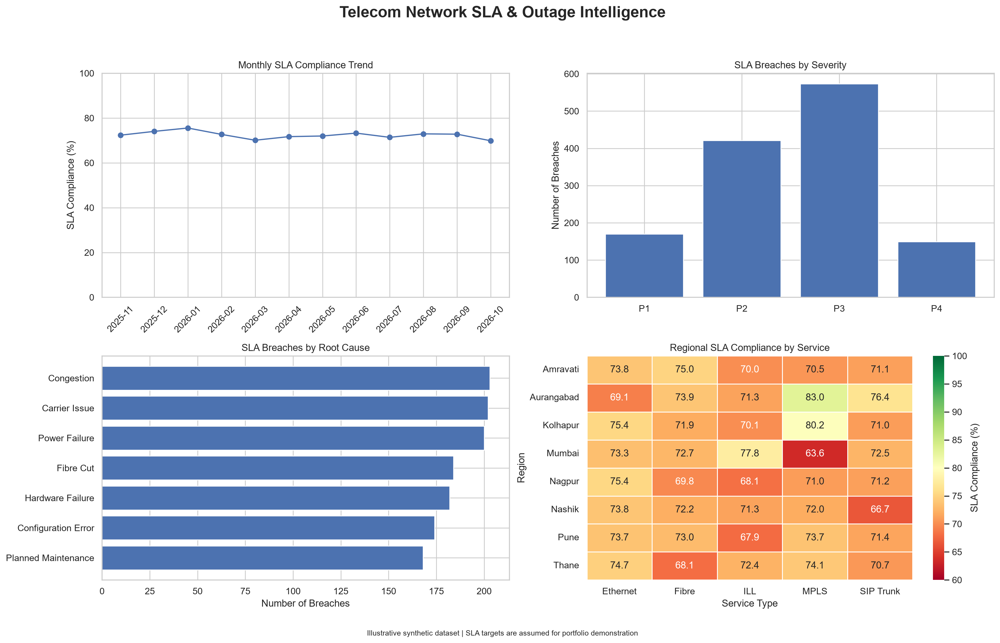

# Telecom Network SLA & Outage Intelligence

## Project Overview
This project analyses regional ticket resolution performance
against defined Service Level Agreement (SLA) targets.

## Objectives
- Calculate regional ticket resolution rates.
- Identify regions breaching their SLA targets.
- Quantify the gap between actual performance and target.
- Highlight regions requiring operational investigation.

## Tools Used
- Python
- Pandas
- Matplotlib
- SQL (SQLite)

## Key Findings
- Total tickets: 400
- Resolved tickets: 372
- Overall resolution rate: 93.00%
- Regions breaching SLA: 2
- Highest SLA gap: Nashik, at 5.00 percentage points below target.

## Files
- telecom_sla_data.csv: Sample dataset
- telecom_sla_analysis.sql: SQL analysis query
- telecom_sla_analysis.ipynb: Python analysis and visualisation

## Important Note
This project uses synthetic sample data for learning and demonstration.
It does not contain actual customer or company data.
## Dashboard Preview

## Expanded Analytics — 5,000 Incident Records

This project includes an expanded synthetic telecom incident dataset covering eight regions, five service types, four severity levels, and multiple network outage root causes.

### Key Analyses
- Monthly SLA compliance and breach trends
- Mean Time to Acknowledge (MTTA)
- Mean Time to Resolve (MTTR)
- Severity-wise incident performance
- Root-cause breach analysis
- Regional and service-level SLA comparisons
- Repeat incident analysis
- SQL-based KPI validation against Python results

### Dashboard

The executive dashboard combines monthly SLA trends, severity-wise breaches, root-cause analysis, and regional-service SLA compliance.

### Technology Stack
Python, Pandas, NumPy, Matplotlib, Seaborn, SQL, SQLite, Jupyter Notebook.

### Data Disclaimer
All incident records are synthetic and generated for portfolio demonstration. SLA targets are illustrative assumptions, not actual customer contracts or verified network performance. Customer impact values represent simulated incident-level counts, not unique customers.

### Validation
Regional incident counts, SLA breach counts, and SLA compliance percentages were independently calculated using Python and SQL and successfully matched.
