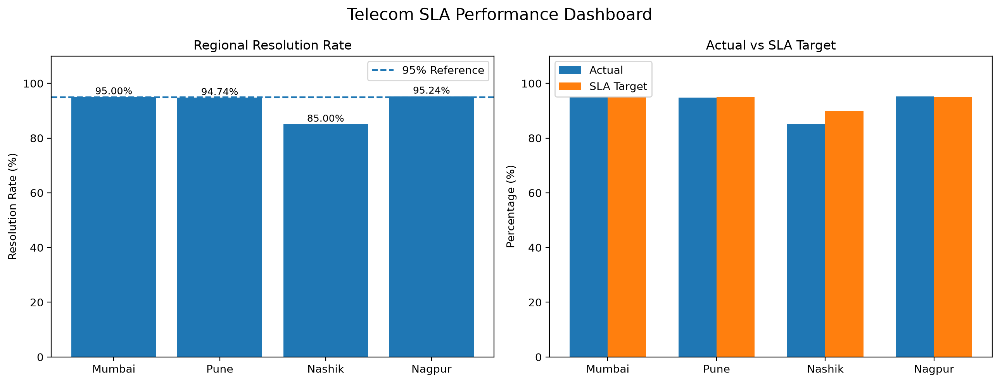

# Telecom Network SLA & Outage Intelligence

## Project Overview
This project analyses regional ticket resolution performance
against defined Service Level Agreement (SLA) targets.

## Objectives
- Calculate regional ticket resolution rates.
- Identify regions breaching their SLA targets.
- Quantify the gap between actual performance and target.
- Highlight regions requiring operational investigation.

## Tools Used
- Python
- Pandas
- Matplotlib
- SQL (SQLite)

## Key Findings
- Total tickets: 400
- Resolved tickets: 372
- Overall resolution rate: 93.00%
- Regions breaching SLA: 2
- Highest SLA gap: Nashik, at 5.00 percentage points below target.

## Files
- telecom_sla_data.csv: Sample dataset
- telecom_sla_analysis.sql: SQL analysis query
- telecom_sla_analysis.ipynb: Python analysis and visualisation

## Important Note
This project uses synthetic sample data for learning and demonstration.
It does not contain actual customer or company data.
## Dashboard Preview

